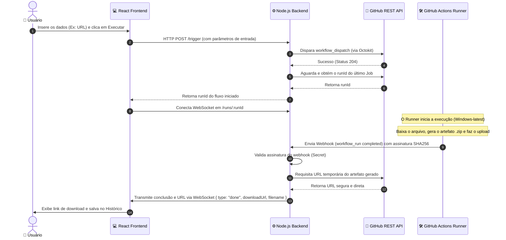

# 📥 Downloader — GitHub Actions Flow Control & Monitor

<p align="center">
  
  
  
  
</p>

Este projeto é a interface visual (**frontend**), construída com **React e TypeScript 7**, e a suíte de workflows de automação de um ecossistema full-stack de download remoto. Ele permite que o usuário gerencie, dispare e monitore downloads executados diretamente na infraestrutura do **GitHub Actions** em tempo real.

---

### 🌐 Acesse a Aplicação em Produção:
👉 **[neotwr.github.io/downloader](https://neotwr.github.io/downloader)**

---

## 🗺️ Arquitetura e Fluxo do Ecossistema

A interface é altamente interativa, orientada a eventos e se conecta de maneira assíncrona ao backend e ao GitHub Actions para obter feedback instantâneo:



---

## ✨ Funcionalidades Principais

*   🚀 **Download via URL Direta**: Baixe qualquer arquivo da internet direto pela infraestrutura do GitHub Actions (extensões como `.exe`, `.msi`, `.zip`, `.rar`, etc.). O link final é servido de forma compactada.
*   🐍 **Download offline de Dependências Python**: Especifique uma ou múltiplas bibliotecas Python (ex: `pandas selenium numpy`). O GitHub runner compila/baixa as wheels compatíveis com `win_amd64` e disponibiliza tudo em um único `.zip`.
*   📦 **Workflows WinGet**: Automações de download e pesquisa de aplicativos no catálogo do Windows Package Manager. A interface atual oferece os modos URL e Python.
*   ⚡ **Monitoramento em Tempo Real (WebSockets)**: A interface avisa em tempo real se o download está disparando, aguardando execução, buscando artefato, finalizado ou se ocorreu algum erro.
*   ⏳ **Histórico de Downloads**: Histórico de downloads persistido localmente no navegador (`localStorage`).
*   🎨 **Interface Premium e Moderna**: UI responsiva construída em React, contendo tratamentos robustos de erros (`ErrorBoundary`), validações de campos e feedback tátil por meio de animações.

---

## 🛠️ Tecnologias Utilizadas

### Frontend
*   **TypeScript 7.0.2** — Tipagem estrita dos componentes, hooks e contratos de comunicação, verificada antes do build.
*   **React 19.3.0** & **Vite 8.3.4** — Interface, servidor de desenvolvimento e geração do bundle de produção.
*   **ESLint 10.12.0** & **typescript-eslint 8.71.2** — Análise estática de TypeScript e regras de React.
*   **Vite Plugin SVGR 5.2.0** — Renderização de ícones SVG como componentes React.
*   **Vanilla CSS3** — Estilização personalizada, com efeitos modernos de Glassmorphism, feedback ativo nos botões e layout responsivo.

### Infraestrutura & CI/CD
*   **Node.js 26.11.1** — Ambiente de desenvolvimento e build definido em `.nvmrc`.
*   **GitHub Actions** — Automação dos downloads em runners virtuais Windows e deploy contínuo do frontend.
*   **GitHub Pages** — Hospedagem serverless do frontend compilado.

---

## 📂 Estrutura de Diretórios

```text
frontend/
├── .github/workflows/    # Workflows do GitHub (Downloads e Deploy)
│   ├── deploy.yml        # Deploy automático do Frontend para o GitHub Pages
│   ├── pip-download.yml  # Workflow de download de dependências Python
│   ├── url-download.yml  # Workflow de download por URL genérica
│   ├── winget-download.yml
│   └── winget-search.yml
├── public/               # Recursos estáticos públicos
├── src/
│   ├── assets/           # Arquivos estáticos e mídias
│   ├── components/       # Componentes React em .tsx (formulários, histórico, ações)
│   ├── config/env.ts     # Validação das variáveis de ambiente e URLs HTTP/WebSocket
│   ├── hooks/useWorkflow.ts # Estado, execução via API e monitoramento WebSocket
│   ├── types/workflow.ts # Contratos de payloads, mensagens, resultados e histórico
│   ├── utils/            # Validação dos dados externos e persistência do histórico
│   ├── vite-env.d.ts     # Tipos das variáveis de ambiente do Vite
│   ├── index.css         # Design system e tokens CSS Globais
│   └── main.tsx          # Ponto de entrada do React
├── index.html            # Estrutura HTML base
├── .nvmrc                # Versão do Node usada localmente e no CI
├── eslint.config.js      # Regras de lint para TypeScript e React
├── tsconfig.json         # Checagem da aplicação (DOM, JSX, noEmit)
├── tsconfig.node.json    # Checagem da configuração do Vite (Node, noEmit)
├── vite.config.ts        # Configuração do Vite
└── package.json          # Dependências do cliente
```

---

## ⚙️ Configuração do Ambiente

Crie um arquivo `.env` na raiz da pasta `frontend/` com base nas variáveis abaixo:

```env
VITE_API_URL=http://localhost:3000
VITE_WORKFLOW_URL=URLDownload
VITE_WORKFLOW_PYTHON=PyDownload
```

Você também pode copiar `.env.example` para `.env`. Os nomes `URLDownload` e `PyDownload` são os identificadores lógicos aceitos pelo backend; os IDs reais dos workflows são resolvidos pelo servidor. Em produção, use o endereço HTTPS público da API.

As variáveis são validadas na inicialização. O Vite incorpora seus valores ao bundle durante o build; alterar a configuração de produção exige gerar e publicar um novo build.

---

## 💻 Como Executar Localmente

### Pré-requisitos
Use [Node.js 26.11.1](https://nodejs.org/), conforme `.nvmrc` e o CI. Com nvm, execute `nvm install` e `nvm use` na raiz do projeto. Para o correto funcionamento em tempo real, o backend correspondente deve estar ativo.

### Passo a Passo
1. Instale as dependências:
   ```bash
   npm ci
   ```
2. Inicie o servidor de desenvolvimento do Vite:
   ```bash
   npm run dev
   ```
3. Acesse o endereço local exibido no terminal (geralmente `http://localhost:5173`) para interagir com a aplicação.

---

## Verificação do código

```bash
npm run typecheck  # TypeScript 7: verifica tipos sem emitir JS
npm run lint       # ESLint: regras de TypeScript e React
npm run build      # Checagem de tipos, lint e bundle de produção
npm run preview    # Serve localmente o build já gerado em dist/
```

O Vite gera o JavaScript final. O compilador TS7 usa o alias `@typescript/native`; o pacote `typescript` fornece a API TS6 de compatibilidade usada pelo ESLint.

`npm run typecheck` verifica tanto a aplicação quanto `vite.config.ts`, com configurações separadas para navegador e Node. Componentes usam `.tsx`, e hooks e utilitários usam `.ts`. Os dados recebidos da API, do WebSocket e do histórico são validados em execução, além dos contratos estáticos.

## 🚀 Implantação e Deploy (GitHub Pages)

O projeto já conta com o workflow do GitHub Actions em `.github/workflows/deploy.yml` configurado para automatizar o deploy.

Para configurá-lo:
1. Vá nas configurações do seu repositório GitHub em **Settings** > **Secrets and variables** > **Actions**.
2. Adicione as seguintes **Repository Secrets**:
   * `VITE_API_URL`: A URL de produção da sua API (ex: `https://sua-api.onrender.com`).
   * `VITE_WORKFLOW_URL`: `URLDownload`
   * `VITE_WORKFLOW_PYTHON`: `PyDownload`
3. Em **Settings** > **Pages**, configure **Source: Deploy from a branch**, branch **`gh-pages`** e pasta **`/(root)`**, conforme o modelo de publicação deste projeto.
4. Integre a branch de migração à `main`. O workflow de deploy é disparado por pushes na `main`; pushes apenas em `migrate/frontend-ts7` não publicam o site.
5. Confira a execução **Deploy Frontend to GitHub Pages** na aba **Actions**.

O workflow instala o Node definido em `.nvmrc`, executa `npm ci` e `npm run build`, e publica o conteúdo de `dist/` na branch `gh-pages`. A permissão `contents: write` já está declarada no workflow. O GitHub Pages recebe HTML, CSS e JavaScript compilados, sem precisar executar TypeScript.

---

## 📄 Notas & Limites
* Os arquivos baixados pelo runner virtual são temporariamente guardados nos artefatos da execução do GitHub Actions e expiram automaticamente conforme configurado nos arquivos `.yml` (normalmente entre 1 e 2 dias), garantindo que nenhum dado fique armazenado permanentemente.
